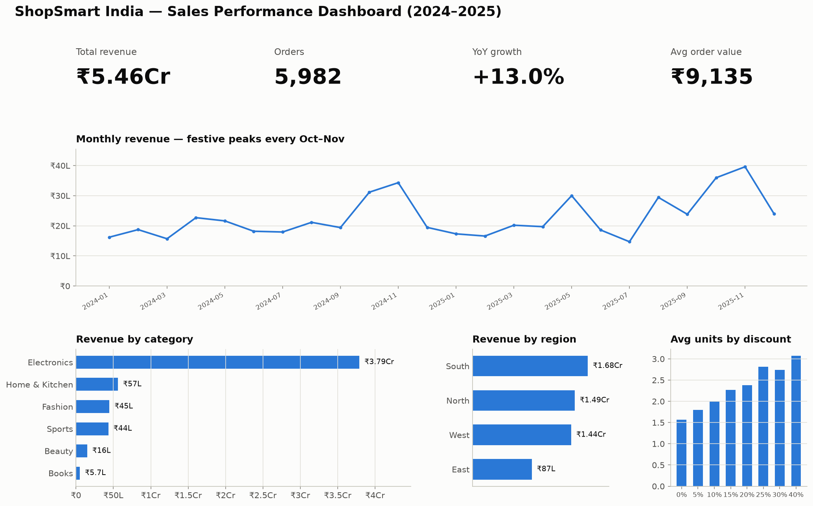
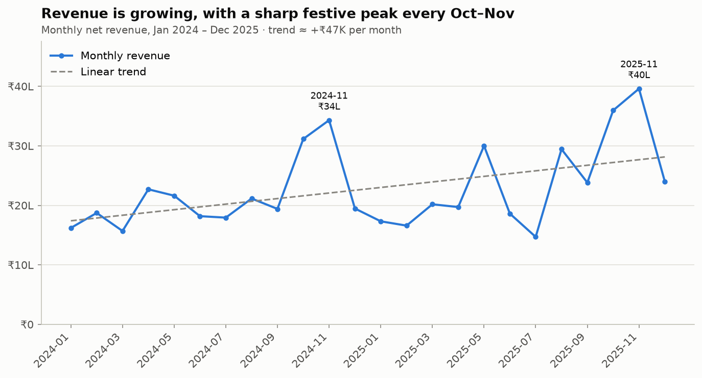
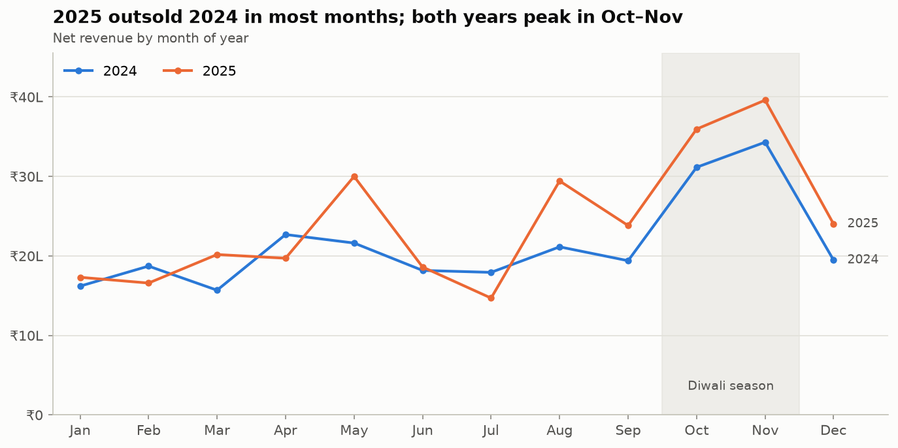
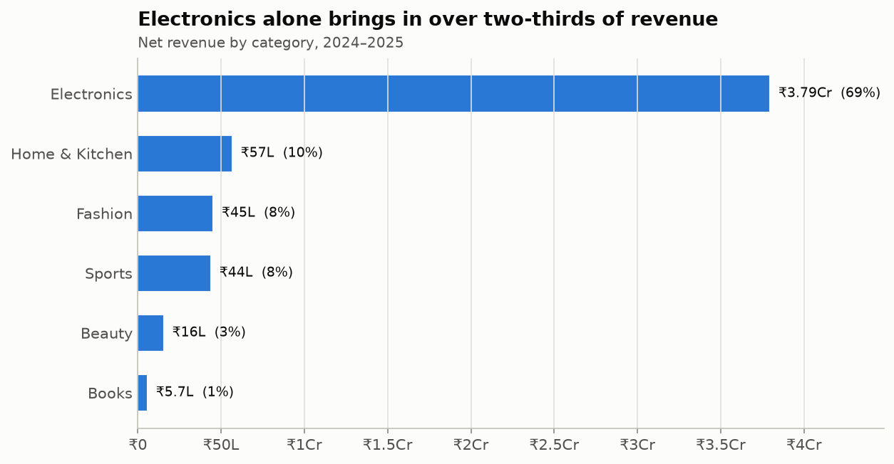
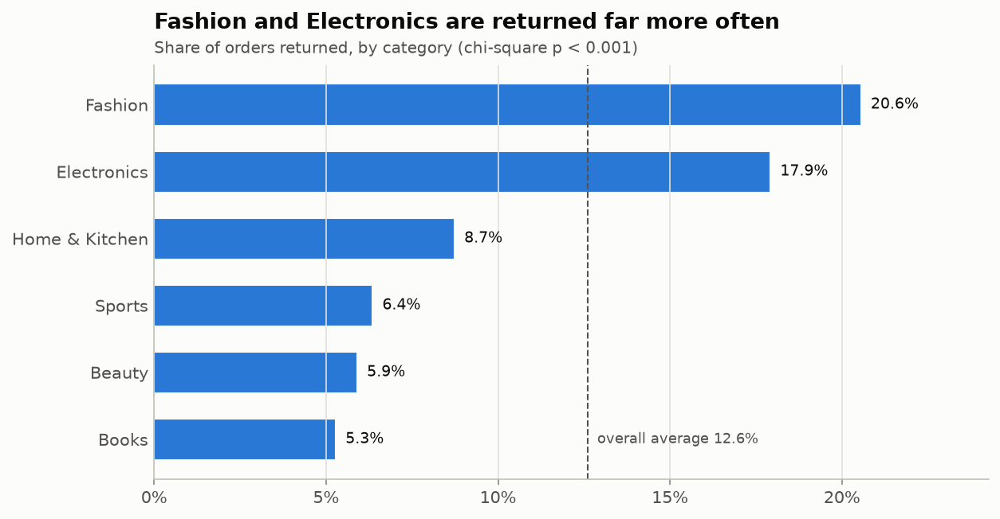
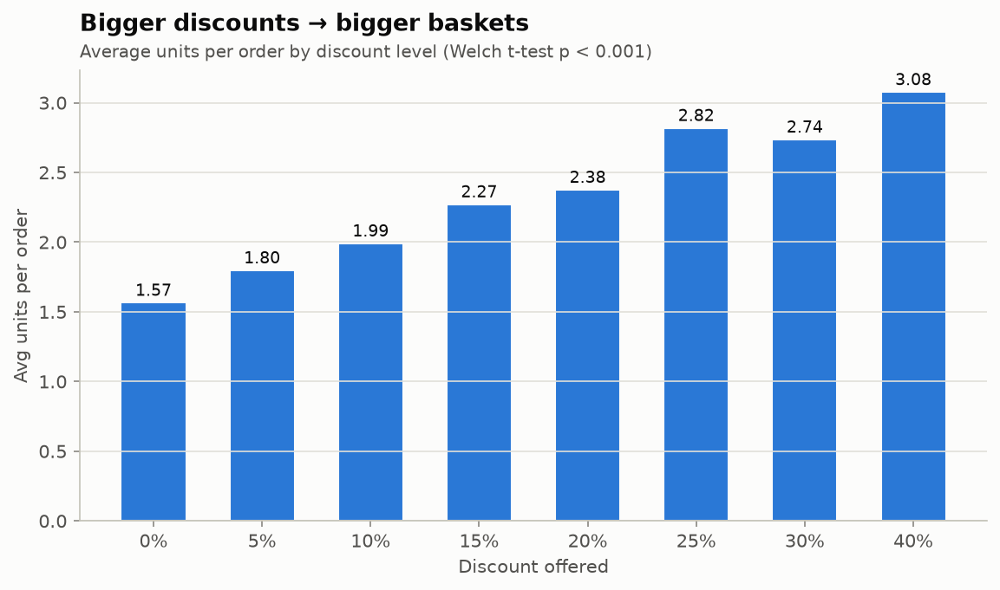
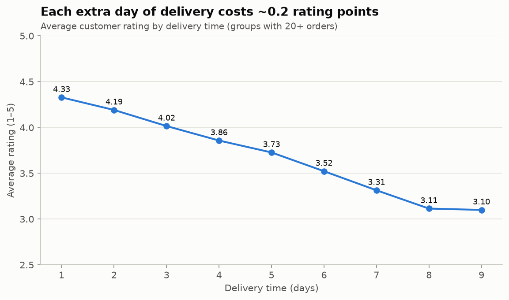
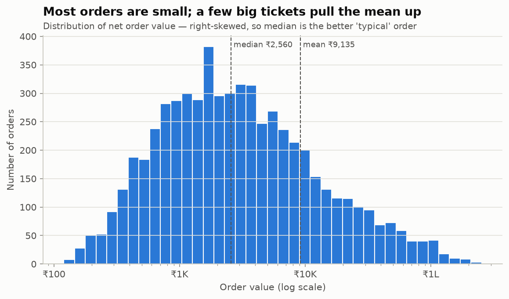
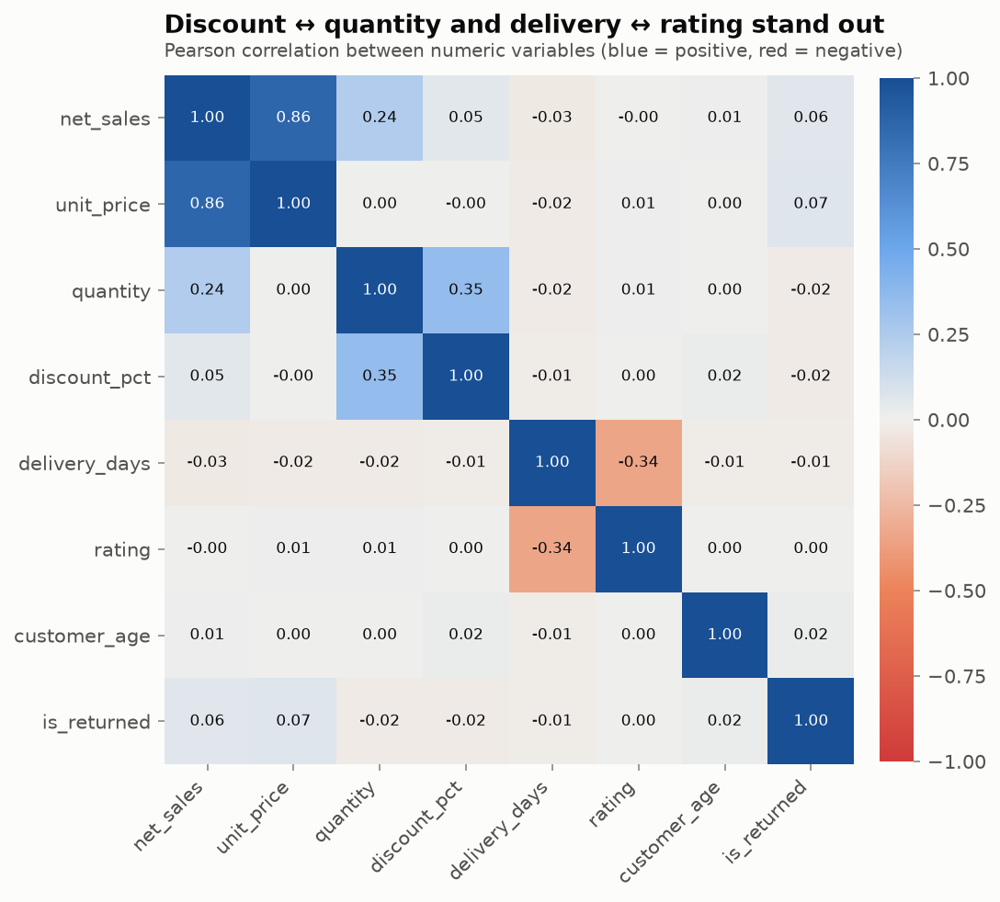

# Retail Sales Analysis — ShopSmart India (2024–2025)

End-to-end data analytics project: raw, messy sales export → cleaned dataset →
KPIs, EDA and hypothesis tests → Matplotlib charts → formatted, formula-driven Excel report.

**Stack:** Python · pandas · NumPy · Matplotlib · `statistics` + SciPy · Excel (openpyxl)



---

## Business questions
1. How is revenue trending, and is there seasonality?
2. Which categories, regions and customer segments drive revenue?
3. Do discounts change buying behaviour?
4. What drives product returns and low customer ratings?

## Dataset
6,090 raw order lines (5,982 after cleaning), Jan 2024 – Dec 2025, 16 columns:
order, date, customer (age, gender), city/region, category/sub-category, price,
quantity, discount, payment method, delivery days, rating, returned.

The data is synthetic (generated by `src/generate_data.py`, fixed seed) but built
with realistic patterns — Diwali seasonality, YoY growth, discount effects — and
realistic problems: duplicates, missing values, mixed date formats, inconsistent
text, impossible values.

## Project structure
```
retail_sales_analysis/
├── main.py                     # runs the whole pipeline
├── build_notebook.py           # rebuilds + executes the notebook
├── requirements.txt
├── data/
│   ├── raw/sales_raw.csv       # messy export
│   └── processed/sales_clean.csv
├── src/
│   ├── generate_data.py        # step 0 – synthetic data
│   ├── clean.py                # step 1 – cleaning + audit log
│   ├── analysis.py             # step 2 – KPIs, EDA, statistics
│   ├── visualize.py            # step 3 – 13 Matplotlib charts
│   └── excel_report.py         # step 4 – Excel workbook
├── notebooks/Retail_Sales_Analysis.ipynb   # narrative walkthrough (executed)
└── outputs/
    ├── charts/*.png
    └── reports/
        ├── Sales_Analysis_Report.xlsx
        └── key_insights.md
```

## How to run
```bash
pip install -r requirements.txt
python main.py                # regenerates data, charts and the Excel report
python build_notebook.py      # optional: re-executes the notebook
```
Open `Sales_Analysis_Report.xlsx` in Excel — formulas recalculate on open.

## Methodology

**1. Data cleaning (pandas / NumPy)** — every step is logged in the `Cleaning_Log` sheet
| Problem | Fix |
|---|---|
| 90 duplicate rows | `drop_duplicates()` |
| Mixed case / extra spaces in city & category | `.str.strip().str.title()` |
| `upi`, `Y`/`N` variants | mapped to standard labels |
| 300 dates in DD/MM/YYYY | parsed both formats, combined |
| Negative prices | sign error → absolute value |
| Quantity = 999 placeholder | rows removed |
| Age > 100 / missing age | set to NaN → median imputation |
| Missing region | recovered from city lookup |
| Missing payment method | labelled `Unknown` |
| Missing rating | left as NaN (customer didn't rate) |

Engineered features: gross/net sales, discount amount, year, month, quarter, weekday, age group.

**2. Statistics**
- Descriptive: mean, median, mode, std dev, variance, quartiles, IQR, skewness (`statistics` module + NumPy)
- Outliers: IQR rule — 768 high-value orders kept (genuine Electronics purchases, 67% of revenue)
- Hypothesis tests (SciPy, α = 0.05):

| Test | Question | Result |
|---|---|---|
| Welch t-test | Do discounted orders have more units? | Significant (+36% units) |
| ANOVA / Kruskal-Wallis | Does order value differ by region? | Not significant |
| Chi-square | Are returns linked to category? | Significant |
| Pearson / Spearman | Slower delivery → lower rating? | Significant, r = −0.34 |
| Linear regression | Is revenue trending up? | Significant, ≈ +₹47K/month |
| Mann-Whitney U | Bigger baskets in festive months? | Not significant |
| 95% CI | Average order value | ₹8,628 – ₹9,643 |

**3. Excel report** (10 sheets) — KPI dashboard, monthly trend, category/region pivots,
statistics and outlier check built with live formulas (`SUMIFS`, `COUNTIFS`,
`AVERAGEIFS`, `MEDIAN`, `QUARTILE`, `STDEV`, `SKEW`…) pointing at the `Clean_Data` table,
plus native Excel charts, conditional formatting, hypothesis-test results, segments,
the cleaning log and all Matplotlib charts.

## Key insights
1. Revenue grew **13.0% YoY** (₹2.57 Cr → ₹2.90 Cr).
2. **Electronics = 69% of revenue** from only 22% of orders.
3. **Oct–Nov (Diwali) average 1.7× the revenue** of other months — driven by more orders, not bigger baskets.
4. **South** leads (₹1.68 Cr); **East** is smallest (₹0.87 Cr) and has the slowest deliveries.
5. **UPI** is the top payment method (43% of orders).
6. **Discounts lift basket size**: 30%+ discount → 2.9 units vs 1.6 at full price.
7. **Slower delivery hurts ratings**: 4.33 (1-day) → 3.10 (9-day).
8. **Returns depend on category**: Fashion 20.6%, Electronics 17.9% vs Books 5.3%.
9. **Top 25% of customers generate 70% of revenue.**

## Recommendations
- Protect Electronics availability and pricing ahead of the festive season.
- Scale logistics and support for Oct–Nov volume, not just discounting.
- Fix East-region delivery times to lift ratings.
- Cut Fashion returns with size guides and better product imagery.
- Use discounts for bundles / multi-buy, where they demonstrably raise units.
- Launch a loyalty programme for Premium customers.

## Charts
| | |
|---|---|
|  |  |
|  |  |
|  |  |
|  |  |
